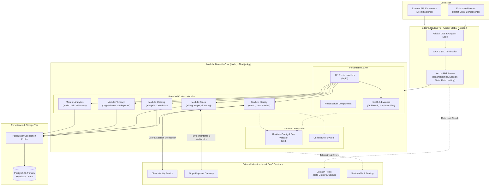

# Morland Chambers Vector (MCV) — Technical Architecture Specification

**Document Version:** 1.0.0  
**Status:** Approved / Active Baseline  
**Classification:** Enterprise Engineering Documentation  
**Authors:** Principal Systems Engineer & Tech Lead

---

## 1. Architectural Philosophy: The Modular Monolith

Morland Chambers Vector (MCV) is engineered as a **Modular Monolith** deployed on modern edge/serverless infrastructure.

```
                                MCV MODULAR MONOLITH
┌─────────────────────────────────────────────────────────────────────────────────┐
│  Presentation Layer: Next.js App Router (Server & Client Components)            │
├─────────────────────────────────────────────────────────────────────────────────┤
│  API Gateway & Handlers: Route Handlers (`src/app/api/*`) & Server Actions     │
├─────────────────────────────────────────────────────────────────────────────────┤
│                               Bounded Contexts                                 │
│  ┌───────────────┐ ┌───────────────┐ ┌───────────────┐ ┌───────────────┐       │
│  │   Identity    │ │    Catalog    │ │     Sales     │ │    Tenancy    │  ...   │
│  └───────┬───────┘ └───────┬───────┘ └───────┬───────┘ └───────┬───────┘       │
│          └─────────────────┴────────┬────────┴─────────────────┘               │
│                                     ▼                                           │
│                       Public Domain APIs (`index.ts`)                           │
├─────────────────────────────────────────────────────────────────────────────────┤
│  Shared Foundation: `src/common` (Config, Errors, Types, Database, Utils)       │
└─────────────────────────────────────────────────────────────────────────────────┘
```

### 1.1 Rationale for Modular Monolith over Distributed Microservices

1. **Developer Velocity & Type Integrity**: Single unified TypeScript abstract syntax tree ensures 100% end-to-end type safety from database models to frontend components with zero code generation drift.
2. **Elimination of Distributed Failure Modes**: No internal network latency, partial failures, distributed deadlocks, or two-phase commit overhead for co-located domain operations.
3. **Clean Bounded Contexts**: Strictly isolated module folders (`src/modules/*`) with public facade exports (`index.ts`). Modules must not reach into private internals of another module.
4. **Frictionless Extraction Path**: If a particular domain (such as vector computing or high-volume telemetry ingestion) demands isolated scaling in the future, its bounded context can be extracted into an independent microservice (e.g., FastAPI service) with minimal refactoring.

---

## 2. Comprehensive Folder Structure

```
mcvlive/
├── .env.example                     # Canonical environment variable specification
├── .gitignore                       # Enterprise git exclusions
├── .prettierrc                      # Prettier code formatting rules
├── .prettierignore                  # Prettier ignore targets
├── AGENTS.md                        # Project memory, AI operating rules & stack locks
├── eslint.config.mjs                # Modern flat ESLint configuration
├── next.config.ts                   # Next.js configuration & compiler rules
├── package.json                     # NPM dependencies and operational scripts
├── tsconfig.json                    # Strict TypeScript compiler options
├── vitest.config.ts                 # Vitest test runner configuration
│
├── docs/                            # Architectural documentation & ADRs
│   ├── system-design.md             # System design specifications
│   ├── architecture.md              # Technical architecture documentation
│   └── decisions/                   # Architecture Decision Records (ADRs)
│       └── 0001-modular-monolith.md # ADR 0001: Selection of Modular Monolith
│
├── tests/                           # System-wide integration and unit tests
│   ├── env.test.ts                  # Runtime environment validation tests
│   └── health.test.ts               # Healthcheck & liveness probe tests
│
└── src/                             # Source code root
    ├── instrumentation.ts           # Next.js server startup hook (env validation)
    │
    ├── app/                         # Next.js App Router (Routes & Layouts)
    │   ├── api/                     # HTTP API Route Handlers
    │   │   └── health/              # System readiness healthcheck endpoint
    │   │       ├── route.ts         # GET /api/health
    │   │       └── live/            # Container/orchestrator liveness probe
    │   │           └── route.ts     # GET /api/health/live
    │   ├── globals.css              # Global Tailwind CSS styles
    │   ├── layout.tsx               # Root application layout
    │   └── page.tsx                 # Root landing page
    │
    ├── common/                      # Cross-cutting foundational utilities
    │   ├── config/                  # Validated environment & runtime configurations
    │   │   └── env.ts               # Zod-backed environment validator
    │   ├── constants/               # System-wide immutable constants
    │   ├── errors/                  # Standardized domain error classes
    │   ├── types/                   # Platform-wide TypeScript type declarations
    │   └── utils/                   # Reusable pure utility functions
    │
    └── modules/                     # Bounded Domain Modules
        ├── identity/                # Authentication, User profiles, IAM, RBAC
        │   ├── index.ts             # Public facade interface
        │   └── types.ts             # Identity domain contracts
        ├── catalog/                 # Software products, Architecture blueprints
        │   ├── index.ts             # Public facade interface
        │   └── types.ts             # Catalog domain contracts
        ├── sales/                   # Invoicing, Subscriptions, Stripe checkout, Licenses
        │   ├── index.ts             # Public facade interface
        │   └── types.ts             # Sales domain contracts
        ├── tenancy/                 # Multi-tenant isolation, Workspace provisioning
        │   ├── index.ts             # Public facade interface
        │   └── types.ts             # Tenancy domain contracts
        └── analytics/               # Telemetry, Audit logging, Performance metrics
            ├── index.ts             # Public facade interface
            └── types.ts             # Analytics domain contracts
```

---

## 3. Background Job & Asynchronous Processing Strategy

To ensure sub-200ms user request latencies, all compute-heavy or external I/O tasks are offloaded from the synchronous HTTP request-response cycle:

```
[ HTTP Request ] ──► [ Route Handler ] ──► [ Publish Event / Enqueue Job ] ──► [ 202 Accepted ]
                                                        │
                                                        ▼
                                             [ Queue / Redis / Inngest ]
                                                        │
                                                        ▼
                                             [ Asynchronous Worker ]
                                            - PDF Invoice Generation
                                            - Cryptographic License Signing
                                            - Webhook Dispatch
                                            - Telemetry Aggregation
```

1. **Lightweight Distributed Task Queue**: Using Redis-backed queuing (Upstash Redis) or durable execution engines (Inngest / BullMQ).
2. **Reliable Webhook Ingestion**: Webhook handlers (e.g., Stripe, Clerk) immediately verify signatures, persist the raw event to an `idempotency_events` database table, enqueue processing, and return HTTP 200.
3. **Scheduled Tasks (Cron)**: Managed via Vercel Cron jobs invoking secured internal API endpoints protected by authorization bearer tokens (`CRON_SECRET`).
4. **Failure Recovery & Dead Letter Queues (DLQ)**: Failed asynchronous jobs execute with exponential backoff up to 5 retries before routing to a Dead Letter Queue with Sentry alerting.

---

## 4. Third-Party Integrations & Service Matrix

| Service             | Category           | Functionality in MCV                                   | Criticality | Fallback / SLA                           |
| :------------------ | :----------------- | :----------------------------------------------------- | :---------- | :--------------------------------------- |
| **Vercel**          | Hosting & CDN      | Global Edge CDN, Serverless runtime, SSL provisioning  | Critical    | 99.99% multi-zone edge routing           |
| **Supabase / Neon** | Relational DB      | PostgreSQL with PgBouncer, automated backups, RLS      | Critical    | Automated daily snapshot + WAL streaming |
| **Clerk**           | Auth & IAM         | Multi-tenant user directory, SAML/SSO, session tokens  | Critical    | JWT local verification on edge           |
| **Stripe**          | Payment Gateway    | Credit cards, ACH, wire invoices, subscription billing | High        | Idempotent webhook queueing              |
| **Upstash Redis**   | Cache & Rate Limit | Distributed token bucket rate limiting, session cache  | High        | Graceful degradation if cache misses     |
| **Sentry**          | Observability      | Real-time crash alerting, tracing, performance APM     | Medium      | Asynchronous non-blocking transport      |

---

## 5. Architectural Component Diagram (Mermaid)


