# Morland Chambers Vector (MCV) — Database Schema & Entity-Relationship Diagram (ERD)

**Document Version:** 1.0.0  
**Status:** Approved / Active Baseline  
**Classification:** Enterprise Engineering Documentation  
**Layer:** Layer 3 — Persistence & Storage Tier  
**Database Engine:** PostgreSQL 18+ (Neon / Supabase Compatible)  
**ORM:** Drizzle ORM

---

## 1. Architectural Invariants Enforced in Database Schema

1. **Strict Multi-Tenant Scoping**:
   - Every tenant-owned table explicitly includes an `organization_id` foreign key with `ON DELETE CASCADE` cascade rules.
2. **Standardized Identity & Timestamps**:
   - Every table uses a UUID `id` primary key (`gen_random_uuid()`).
   - Every table maintains timezone-aware `created_at` and `updated_at` timestamps (`timestamp with time zone DEFAULT now()`).
3. **Tenant Data Recovery via Soft Deletes**:
   - Soft deletes are implemented via nullable `deleted_at timestamp with time zone` across every entity. All operational queries filter `deleted_at IS NULL`.
4. **Relational Constraints & Integrity**:
   - All role, status, environment, and category fields are guarded with database-level `CHECK` constraints instead of relying solely on application-level validations.
5. **Integer Minor Unit Currency Representation**:
   - Monetary values (`subtotal_minor`, `discount_minor`, `tax_minor`, `total_minor`, `amount_due_minor`, `amount_paid_minor`) are stored strictly as integer minor units (e.g. cents/paise) with non-negative `CHECK` constraints, preventing floating-point rounding errors.
6. **Comprehensive B-Tree Indexing**:
   - All foreign keys, status filters, tenant scopes, unique identifiers, and timestamp sort targets are indexed.

---

## 2. Mermaid Entity-Relationship Diagram (ERD)

```mermaid
erDiagram
    ORGANIZATIONS ||--o{ ORGANIZATION_MEMBERS : "has"
    USERS ||--o{ ORGANIZATION_MEMBERS : "belongs_to"
    ORGANIZATIONS ||--o{ WORKSPACES : "owns"
    ORGANIZATIONS ||--o{ QUOTES : "receives"
    ORGANIZATIONS ||--o{ LICENSES : "holds"
    ORGANIZATIONS ||--o{ INVOICES : "billed"
    ORGANIZATIONS ||--o{ STORAGE_FILES : "stores"
    ORGANIZATIONS ||--o{ AUDIT_LOGS : "records"
    QUOTES ||--o{ LICENSES : "generates"
    QUOTES ||--o{ INVOICES : "settled_via"
    USERS ||--o{ STORAGE_FILES : "uploads"
    USERS ||--o{ AUDIT_LOGS : "triggers"

    ORGANIZATIONS {
        uuid id PK "gen_random_uuid()"
        varchar name "NOT NULL"
        varchar slug UK "NOT NULL, uniqueIndex"
        varchar status "NOT NULL, CHECK in ('active', 'suspended', 'provisioning')"
        varchar domain "Nullable corporate domain"
        timestamptz created_at "NOT NULL, default now()"
        timestamptz updated_at "NOT NULL, default now()"
        timestamptz deleted_at "Nullable, soft delete"
    }

    USERS {
        uuid id PK "gen_random_uuid()"
        varchar email UK "NOT NULL, uniqueIndex"
        varchar full_name "NOT NULL"
        text avatar_url "Nullable"
        timestamptz created_at "NOT NULL, default now()"
        timestamptz updated_at "NOT NULL, default now()"
        timestamptz deleted_at "Nullable, soft delete"
    }

    ORGANIZATION_MEMBERS {
        uuid id PK "gen_random_uuid()"
        uuid organization_id FK "REFERENCES organizations(id) ON DELETE CASCADE"
        uuid user_id FK "REFERENCES users(id) ON DELETE CASCADE"
        varchar role "NOT NULL, CHECK in ('org_admin', 'evaluator', 'billing', 'member')"
        timestamptz created_at "NOT NULL, default now()"
        timestamptz updated_at "NOT NULL, default now()"
        timestamptz deleted_at "Nullable, soft delete"
    }

    WORKSPACES {
        uuid id PK "gen_random_uuid()"
        uuid organization_id FK "REFERENCES organizations(id) ON DELETE CASCADE"
        varchar name "NOT NULL"
        varchar slug "NOT NULL, unique with organization_id"
        varchar environment_type "NOT NULL, CHECK in ('production', 'staging', 'sandbox')"
        varchar api_key_prefix "NOT NULL, indexed"
        varchar api_key_hash "NOT NULL"
        timestamptz created_at "NOT NULL, default now()"
        timestamptz updated_at "NOT NULL, default now()"
        timestamptz deleted_at "Nullable, soft delete"
    }

    QUOTES {
        uuid id PK "gen_random_uuid()"
        uuid organization_id FK "REFERENCES organizations(id) ON DELETE CASCADE"
        varchar quote_number UK "NOT NULL, uniqueIndex"
        varchar tier "NOT NULL, CHECK in ('starter', 'enterprise_standard', 'vector_sovereign')"
        integer seats "NOT NULL, default 1, CHECK > 0"
        varchar currency "NOT NULL, default 'USD', 3 chars"
        integer subtotal_minor "NOT NULL, minor cents, CHECK >= 0"
        integer discount_minor "NOT NULL, minor cents, CHECK >= 0"
        integer tax_minor "NOT NULL, minor cents, CHECK >= 0"
        integer total_minor "NOT NULL, minor cents, CHECK >= 0"
        varchar status "NOT NULL, CHECK in ('draft', 'pending_approval', 'accepted', 'expired', 'rejected')"
        timestamptz expires_at "NOT NULL, indexed"
        timestamptz created_at "NOT NULL, default now()"
        timestamptz updated_at "NOT NULL, default now()"
        timestamptz deleted_at "Nullable, soft delete"
    }

    LICENSES {
        uuid id PK "gen_random_uuid()"
        uuid organization_id FK "REFERENCES organizations(id) ON DELETE CASCADE"
        uuid quote_id FK "REFERENCES quotes(id) ON DELETE SET NULL"
        varchar license_key UK "NOT NULL, uniqueIndex"
        varchar tier "NOT NULL, CHECK in ('starter', 'enterprise_standard', 'vector_sovereign')"
        varchar status "NOT NULL, CHECK in ('provisioning', 'active', 'suspended', 'expired', 'revoked')"
        timestamptz valid_from "NOT NULL"
        timestamptz valid_until "NOT NULL, indexed"
        jsonb entitlements "NOT NULL, default '{}'"
        timestamptz created_at "NOT NULL, default now()"
        timestamptz updated_at "NOT NULL, default now()"
        timestamptz deleted_at "Nullable, soft delete"
    }

    INVOICES {
        uuid id PK "gen_random_uuid()"
        uuid organization_id FK "REFERENCES organizations(id) ON DELETE CASCADE"
        uuid quote_id FK "REFERENCES quotes(id) ON DELETE SET NULL"
        varchar invoice_number UK "NOT NULL, uniqueIndex"
        varchar stripe_payment_intent_id "Nullable, indexed"
        integer amount_due_minor "NOT NULL, minor cents, CHECK >= 0"
        integer amount_paid_minor "NOT NULL, minor cents, default 0, CHECK >= 0"
        varchar currency "NOT NULL, default 'USD'"
        varchar status "NOT NULL, CHECK in ('unpaid', 'paid', 'void', 'refunded')"
        timestamptz paid_at "Nullable"
        timestamptz created_at "NOT NULL, default now()"
        timestamptz updated_at "NOT NULL, default now()"
        timestamptz deleted_at "Nullable, soft delete"
    }

    STORAGE_FILES {
        uuid id PK "gen_random_uuid()"
        uuid organization_id FK "REFERENCES organizations(id) ON DELETE CASCADE"
        uuid uploaded_by FK "REFERENCES users(id) ON DELETE SET NULL"
        varchar file_name "NOT NULL"
        varchar storage_path UK "NOT NULL, uniqueIndex, scoped by organization_id"
        integer file_size_bytes "NOT NULL, CHECK > 0 AND <= 52428800"
        varchar mime_type "NOT NULL"
        varchar category "NOT NULL, CHECK in ('contract', 'invoice', 'blueprint', 'compliance', 'general')"
        boolean is_private "NOT NULL, default true"
        varchar checksum_sha256 "Nullable"
        timestamptz created_at "NOT NULL, default now()"
        timestamptz updated_at "NOT NULL, default now()"
        timestamptz deleted_at "Nullable, soft delete"
    }

    AUDIT_LOGS {
        uuid id PK "gen_random_uuid()"
        uuid organization_id FK "REFERENCES organizations(id) ON DELETE CASCADE"
        uuid actor_id FK "REFERENCES users(id) ON DELETE SET NULL"
        varchar action "NOT NULL, indexed"
        varchar resource_type "NOT NULL"
        varchar resource_id "NOT NULL"
        jsonb metadata "NOT NULL, default '{}'"
        varchar ip_address "Nullable"
        text user_agent "Nullable"
        timestamptz created_at "NOT NULL, default now(), indexed"
        timestamptz updated_at "NOT NULL, default now()"
        timestamptz deleted_at "Nullable, soft delete"
    }
```

---

## 3. Database Schema Summary Matrix

| Table Name             | Partitioning / Ownership     | Primary Key | Soft Delete  | Cascade Behavior                    |
| :--------------------- | :--------------------------- | :---------- | :----------- | :---------------------------------- |
| `organizations`        | Platform Root Entity         | UUID (`id`) | `deleted_at` | Cascades to all tenant children     |
| `users`                | Platform Identity Entity     | UUID (`id`) | `deleted_at` | Preserves audit trails via SET NULL |
| `organization_members` | Tenant-Owned Join            | UUID (`id`) | `deleted_at` | CASCADE on org/user deletion        |
| `workspaces`           | Tenant-Owned Environment     | UUID (`id`) | `deleted_at` | CASCADE on org deletion             |
| `quotes`               | Tenant-Owned Sales           | UUID (`id`) | `deleted_at` | CASCADE on org deletion             |
| `licenses`             | Tenant-Owned Licensing       | UUID (`id`) | `deleted_at` | CASCADE on org deletion             |
| `invoices`             | Tenant-Owned Billing         | UUID (`id`) | `deleted_at` | CASCADE on org deletion             |
| `storage_files`        | Tenant-Owned Object Metadata | UUID (`id`) | `deleted_at` | CASCADE on org deletion             |
| `audit_logs`           | Tenant-Owned Audit Trail     | UUID (`id`) | `deleted_at` | CASCADE on org deletion             |
